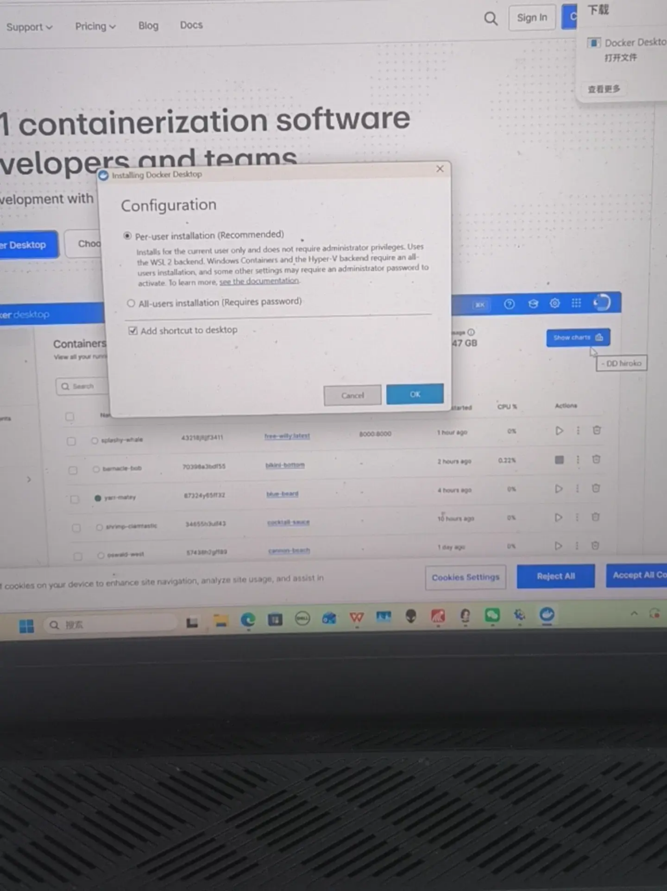
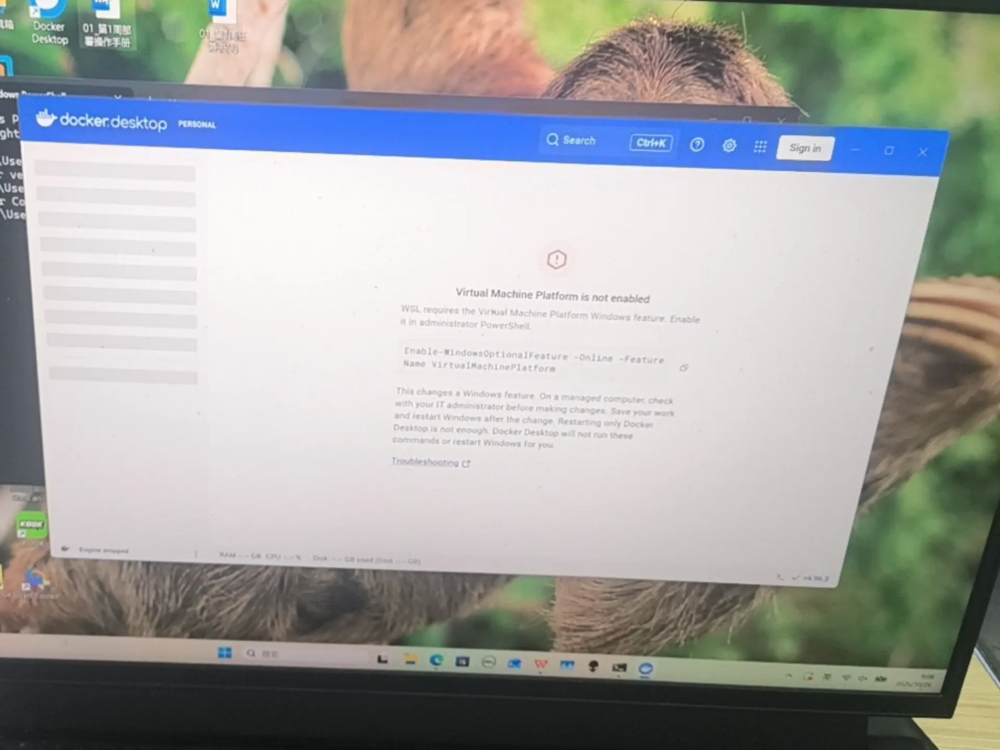
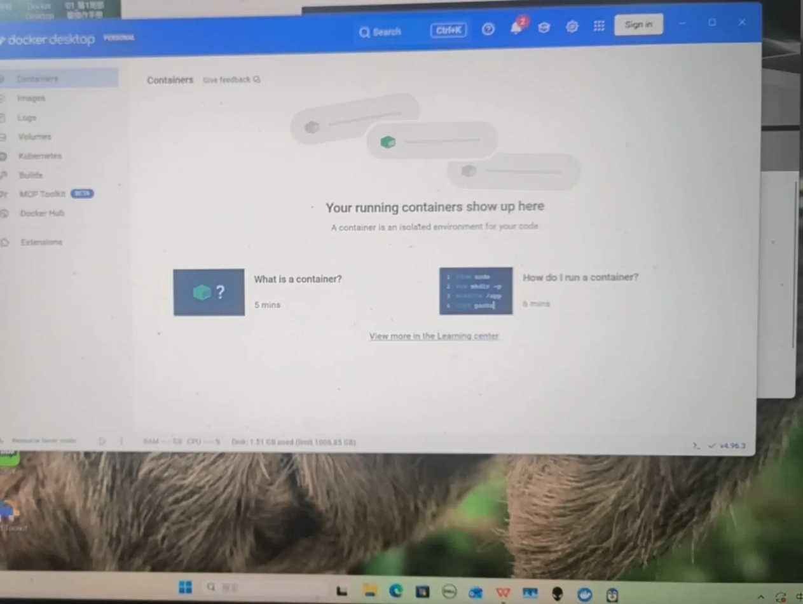
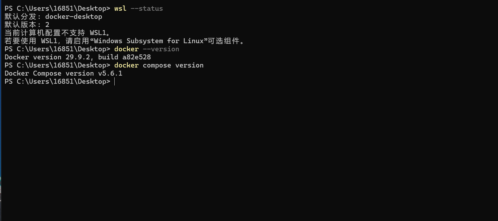
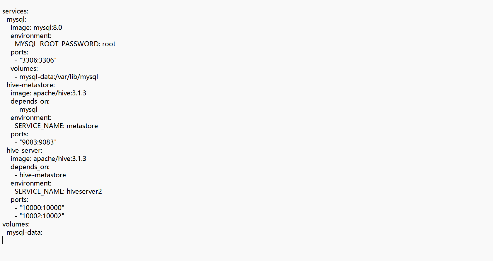
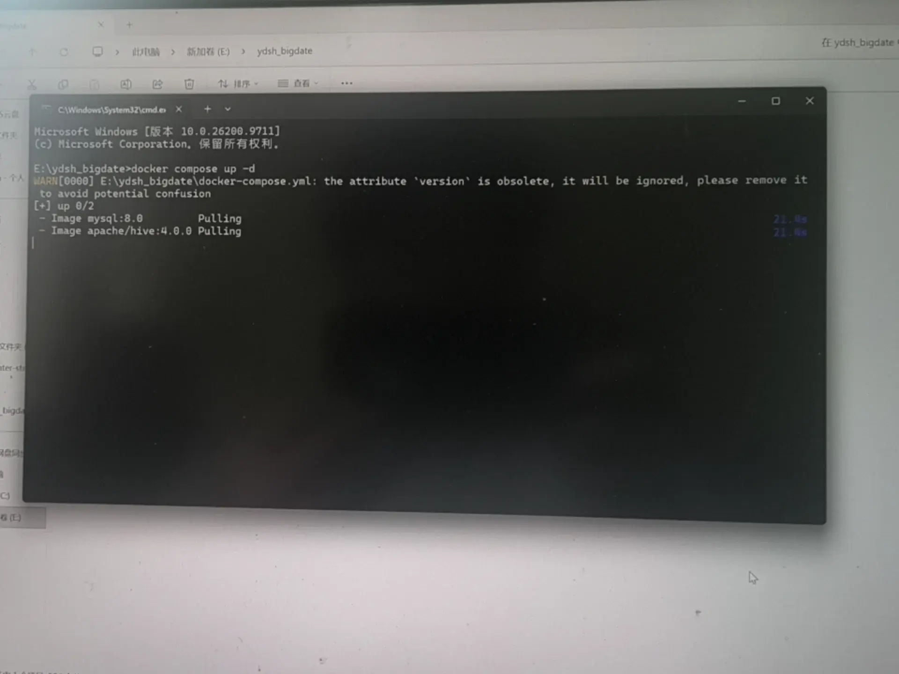
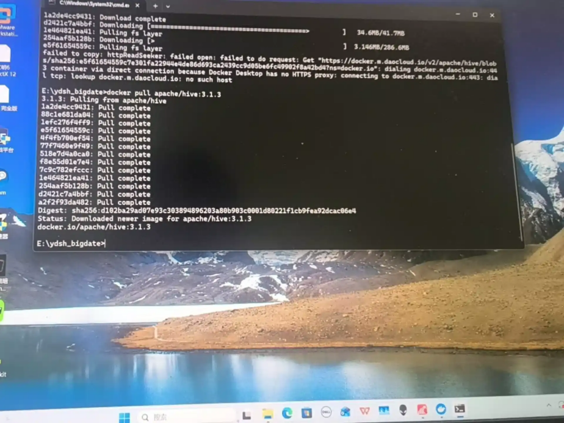
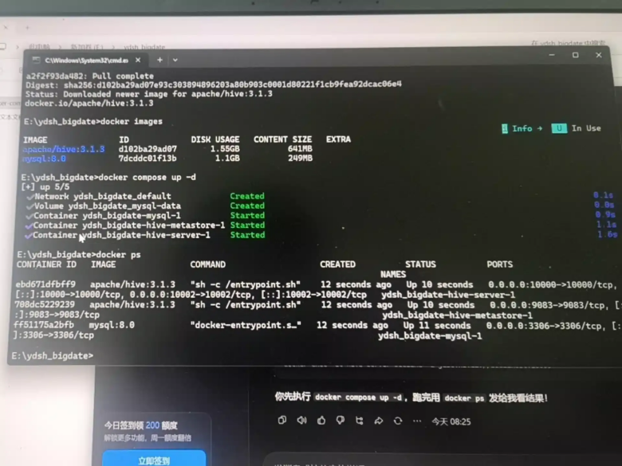
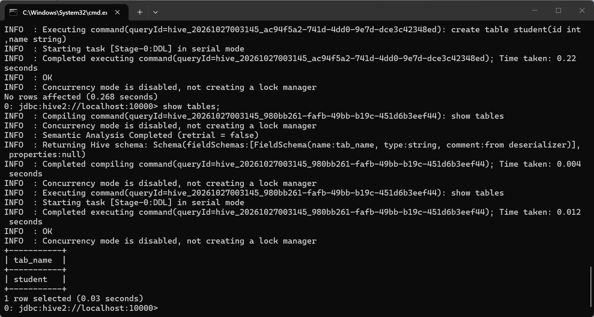

# 第 1 周环境搭建笔记

- 记录人：刘正扬　日期：2026-10-30
- 环境：Windows 11 + WSL2 + Docker Desktop（Docker 29.9.2 / Docker Compose v5.6.1）

## 一、搭建过程

### 1. 下载并安装 Docker Desktop

从 Docker 官网下载 Docker Desktop for Windows，安装向导中选择 **Per-user installation (Recommended)**（使用 WSL 2 backend，无需管理员密码），勾选"Add shortcut to desktop"后点击 OK 开始安装。



### 2. 首次打开报错：Virtual Machine Platform 未启用

安装完成后第一次打开 Docker Desktop，出现报错 **"Virtual Machine Platform is not enabled"**——WSL 需要的"虚拟机平台"Windows 功能没有开启。



报错界面同时给出了修复命令提示：



**解决办法**：打开 Windows PowerShell（管理员），执行以下命令启用虚拟机平台，然后重启电脑：

```powershell
Enable-WindowsOptionalFeature -Online -FeatureName VirtualMachinePlatform
```

重启后再次打开 Docker Desktop 即可正常进入（Engine running）。

### 3. 验证 Docker 安装成功

```powershell
wsl --status                  # 默认发行版 docker-desktop，默认版本 2
docker --version              # Docker version 29.9.2, build a82e528
docker compose version        # Docker Compose version v5.6.1
```

两条版本命令均正常输出版本号、`wsl --status` 显示默认版本为 2，验证通过。



### 4. 编写 docker-compose.yml 启动 Hive + MySQL

在项目根目录（`E:\ydsh_bigdate`）编写 `docker-compose.yml`，编排三个服务：

- **mysql**（mysql:8.0）：Metastore 元数据库，root 密码 root，3306 端口，数据卷 `mysql-data` 持久化；
- **hive-metastore**（apache/hive:3.1.3）：`SERVICE_NAME: metastore`，9083 端口，`depends_on` mysql；
- **hive-server**（apache/hive:3.1.3）：`SERVICE_NAME: hiveserver2`，10000（JDBC）/ 10002（Web UI）端口。



> 后续迭代：为了解决 Metastore 未就绪时 HiveServer2 先起的问题，最终版本给 mysql 加了 **healthcheck**（`mysqladmin ping`），并把 metastore 的 `depends_on` 升级为 `condition: service_healthy`，同时补充了 Metastore 连接 MySQL 的 JDBC 环境变量（`metastore_db`、用户 hive）。

### 5. docker compose up -d 拉取镜像

在项目目录执行 `docker compose up -d`，开始拉取 mysql:8.0 与 apache/hive 镜像（期间有个无害警告：compose v2 已不再需要 `version` 字段，之后从 yml 中移除）：



### 6. 踩坑：配置国内镜像源拉取失败，直接 docker pull 成功

第一次通过配置的国内镜像源（docker.m.daocloud.io）拉取时失败，报错 **"failed to do request: ... dial tcp: lookup docker.m.daocloud.io: no such host"**（镜像加速域名解析不到）。

**解决办法**：不再依赖加速器，直接 `docker pull apache/hive:3.1.3` 从 Docker Hub 官方源拉取，全部层 Pull complete，下载成功。



### 7. 启动成功并验证容器状态

`docker images` 确认 apache/hive:3.1.3 与 mysql:8.0 镜像已就绪；重新执行 `docker compose up -d`，依次创建 network、volume 与三个容器并全部 Started。`docker ps` 显示三个容器均为 **Up** 状态：

- `ydsh_bigdate-mysql-1`（0.0.0.0:3306→3306）
- `ydsh_bigdate-hive-metastore-1`（0.0.0.0:9083→9083）
- `ydsh_bigdate-hive-server-1`（0.0.0.0:10000→10000/tcp、10002→10002/tcp）



### 8. beeline 连接 Hive 验证

通过 beeline 连接 HiveServer2（`jdbc:hive2://localhost:10000`），实际执行建表与查询验证服务可用：

```sql
create table student(id int, name string);   -- OK, Time taken: 0.22 seconds
show tables;                                  -- 返回 student，查询成功
```

DDL/DML 均正常返回 OK，Hive 服务验证通过。



## 二、遇到的问题与解决（汇总）

| 问题 | 现象 | 解决方案 |
|---|---|---|
| 虚拟机平台未启用 | 首次打开 Docker Desktop 报 "Virtual Machine Platform is not enabled" | 管理员 PowerShell 执行 `Enable-WindowsOptionalFeature -Online -FeatureName VirtualMachinePlatform` 后重启 |
| 镜像加速器域名解析失败 | 拉取报 "lookup docker.m.daocloud.io: no such host" | 直接 `docker pull` 官方源拉取 apache/hive:3.1.3 |
| Hive 服务启动顺序 | Metastore 未就绪时 HiveServer2 起不来 | compose 中 `depends_on` + `condition: service_healthy` 保证 MySQL 健康检查通过后再启动 Metastore |
| CSV 表头被当成数据导入 | 导入后第一行变成字段名 | 建表时加 `tblproperties('skip.header.line.count'='1')` |
| CSV 日期格式混乱 | 同一列混用 `2024-07-26` 与 `2024/09/10` | 预评估统计出问题行数（订单表 1902 条），清洗阶段统一为 `YYYY-MM-DD` |
| DWD 数据库创建权限报错 | Hive 默认 warehouse 路径无写权限 | 建库时显式指定 `location '/opt/hive/ydsh_dwd'` |
| 数据文件路径 | `load data local inpath` 是容器内路径 | 将 CSV 放入容器可见目录后加载，用 `count(*)` 与预期行数逐一校验（1000/600/60/15600/37549/60000） |

## 三、验证结果

- `docker ps` 可见 mysql、hive-metastore、hive-server 三个容器运行正常（见截图 8）；
- beeline 连接 HiveServer2 正常，建表/查询均返回 OK（见截图 9）；
- ODS 6 张表建表与数据导入脚本见 `sql/ods/`，清洗脚本见 `sql/clean/`。
